<div align="center">

# 🛡️ Gatekeeper

**A from-scratch OAuth 2.1 / OpenID Connect identity provider - a "mini Keycloak" built with NestJS, Next.js, Prisma and PostgreSQL.**

**[Live demo](https://gatekeeper-lalit.vercel.app)** · [OAuth playground](https://gatekeeper-lalit.vercel.app/playground) · [Admin console](https://gatekeeper-lalit.vercel.app/admin) · [API reference](https://gatekeeper-lalit.vercel.app/docs)

[](https://github.com/rajak312/gatekeeper/actions/workflows/ci.yml)


</div>

> **Try it in 30 seconds:** open the [playground](https://gatekeeper-lalit.vercel.app/playground), click **Sign in with Gatekeeper**, log in as `demo@gatekeeper.dev` / `demo1234`, approve the consent screen and inspect the verified ID token, access token and protocol trace. Then press **Refresh tokens** followed by **Replay an old refresh token** to watch reuse detection revoke the whole token family.
>
> The API runs on a free Render instance that sleeps when idle - the first request can take up to a minute (the UI shows a "waking up the server…" screen meanwhile).

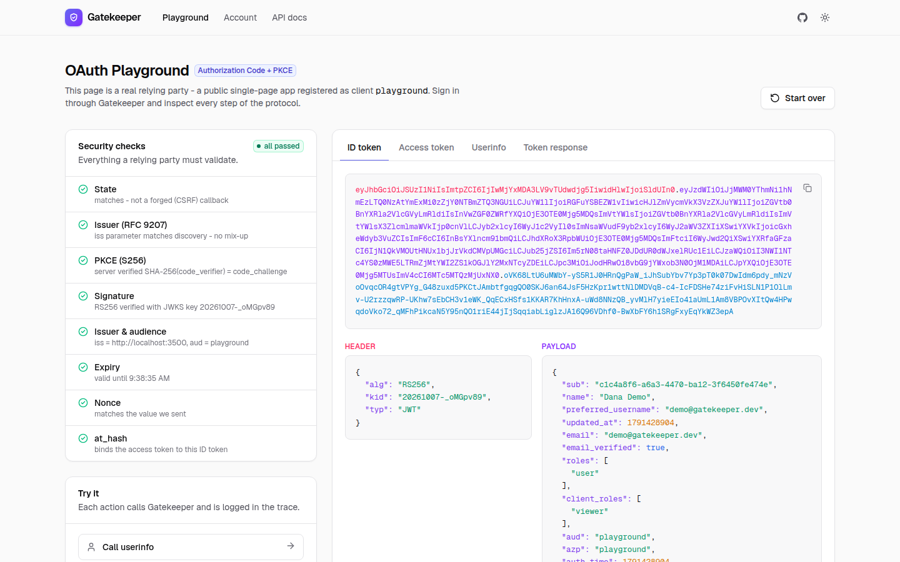

## Demo accounts

| Role  | Email                  | Password    |
| ----- | ---------------------- | ----------- |
| User  | `demo@gatekeeper.dev`  | `demo1234`  |
| Admin | `admin@gatekeeper.dev` | `admin1234` |

The seeded confidential client `acme-reports` (secret `gks_demo_acme_reports_secret_change_me`) can be used to try `client_credentials`, introspection and revocation with curl. In demo mode the shared accounts and the playground client are write-protected (no MFA enrollment, no password change, no lockout) and visitor data is reset every 6 hours.

## Features

**Protocol (OAuth 2.1 + OpenID Connect)**

- Authorization Code flow with **PKCE required for every client (S256 only)**, `state`, `nonce`, exact `redirect_uri` matching and the RFC 9207 `iss` response parameter.
- `prompt=none|login|consent`, `max_age`, consent screen with **remembered grants** (asks again only for new scopes).
- Token endpoint: `authorization_code`, `refresh_token` with **rotation + reuse detection (revokes the whole token family)**, `client_credentials`.
- Client authentication: `client_secret_basic`, `client_secret_post` (secrets stored hashed, shown once), public clients (`none` + PKCE).
- JWT access tokens (`typ: at+jwt`, RFC 9068) with `roles` and Keycloak-style per-client `resource_access` claims; ID tokens with `at_hash`, `amr`, `sid`, `auth_time`.
- Discovery (`/.well-known/openid-configuration` + RFC 8414), JWKS, userinfo, revocation (RFC 7009), introspection (RFC 7662), RP-initiated logout.
- **Signing key rotation**: RS256 keys with `kid`, private keys encrypted at rest (AES-256-GCM); retired keys stay in the JWKS until the tokens they signed have expired.

**Accounts & security**

- Sign up, email + password (**argon2id**, OWASP parameters), email verification and password reset via a pluggable mailer.
- **TOTP MFA** (RFC 6238): QR enrollment, replay protection (a time step can be used once), single-use hashed recovery codes.
- Brute-force protection: per-IP rate limiting (`@nestjs/throttler`) plus per-account lockout; constant-time comparisons and timing-equalised "unknown user" path.
- Sessions list with revoke / "sign out everywhere"; connected-apps list with consent revocation.
- Audit log of security events (logins, MFA, consent, token reuse, client and key changes, admin actions).

**Admin console**

- Dashboard (users, clients, sessions, security alerts, sign-ins per day chart, recent events).
- Applications: create public/confidential clients, redirect URIs, scopes, grant types, token lifetimes, client roles, show-once secret and regeneration.
- Users: search, lock/unlock, reset MFA, global roles, per-client roles, revoke sessions.
- Signing keys (one-click rotation), scopes (custom consent text), filterable audit log, **dev outbox** for emails.

**Engineering**

- TypeScript strict across a npm-workspaces monorepo, shared zod schemas between API and UI.
- Swagger docs for the management API, `/health` with DB check, structured logs (`nestjs-pino`) with secrets redacted.
- 166 automated tests (unit + e2e against real Postgres), ESLint 9 flat config + Prettier, GitHub Actions CI, multi-stage Dockerfiles, docker-compose, Render + Vercel deploy config.

## Screenshots

| | |
| --- | --- |
| 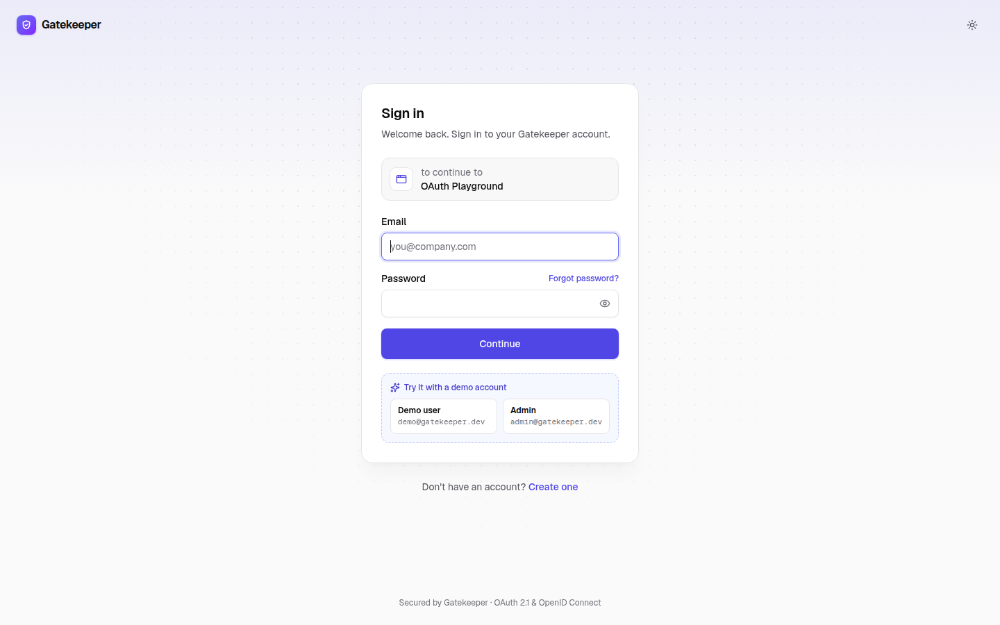 **Hosted login** with "continue to" banner and demo shortcuts | 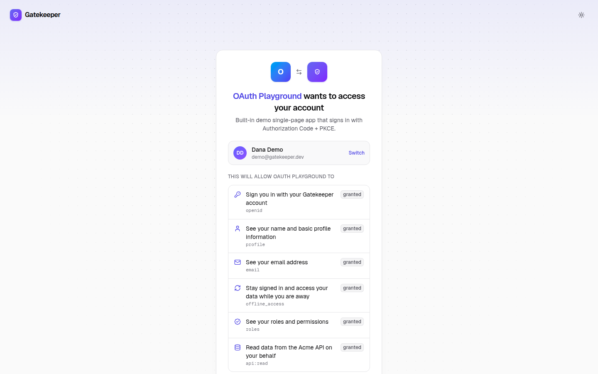 **Consent screen** with per-scope descriptions |
| 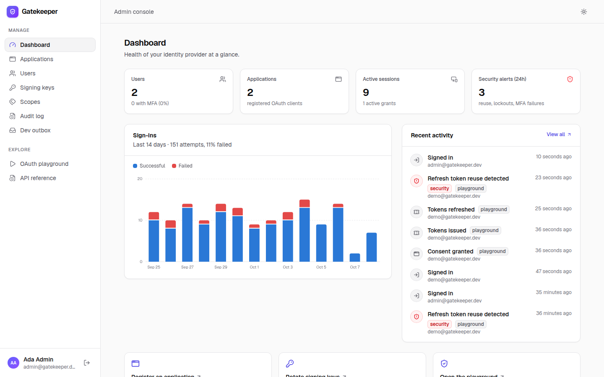 **Admin dashboard** | 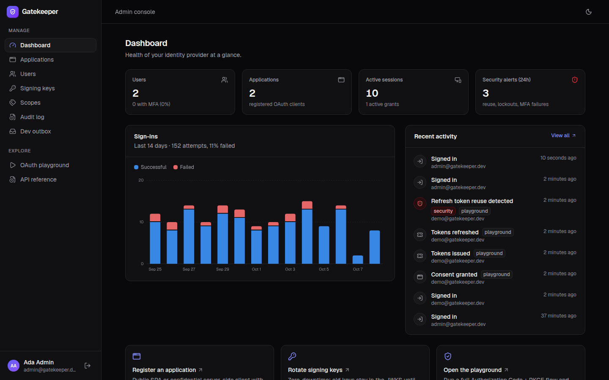 **Dark mode** |
| 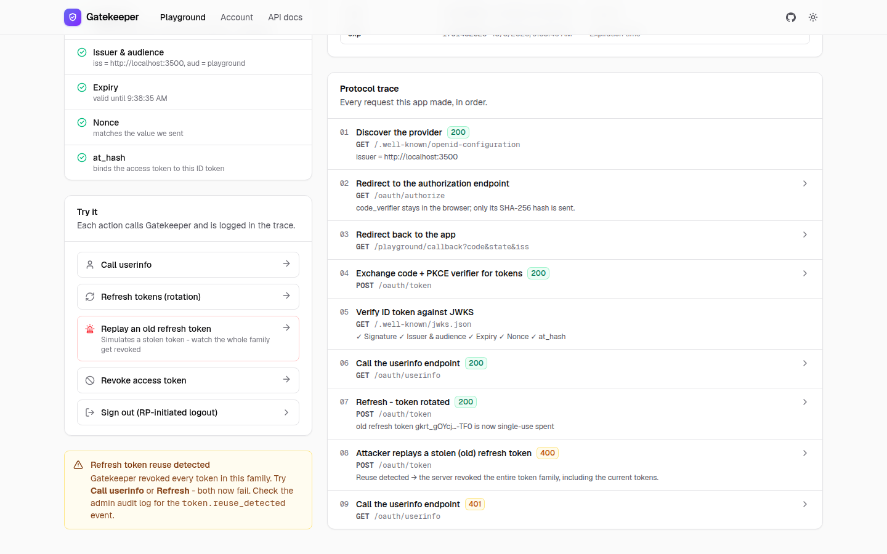 **Refresh token reuse detected** - the whole family is revoked | 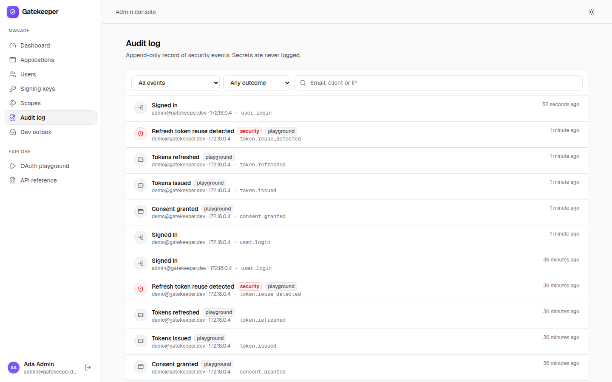 **Audit log** with the `token.reuse_detected` event |
| 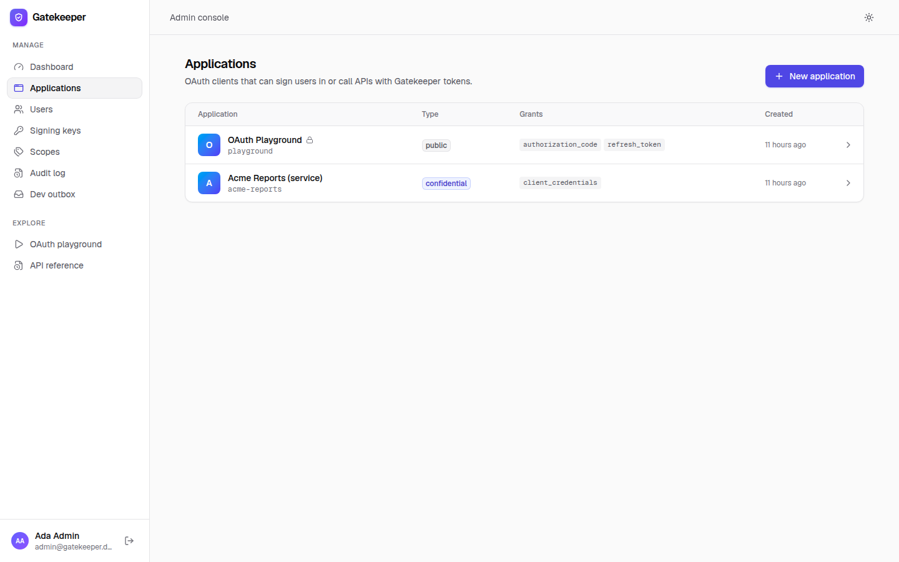 **Applications** | 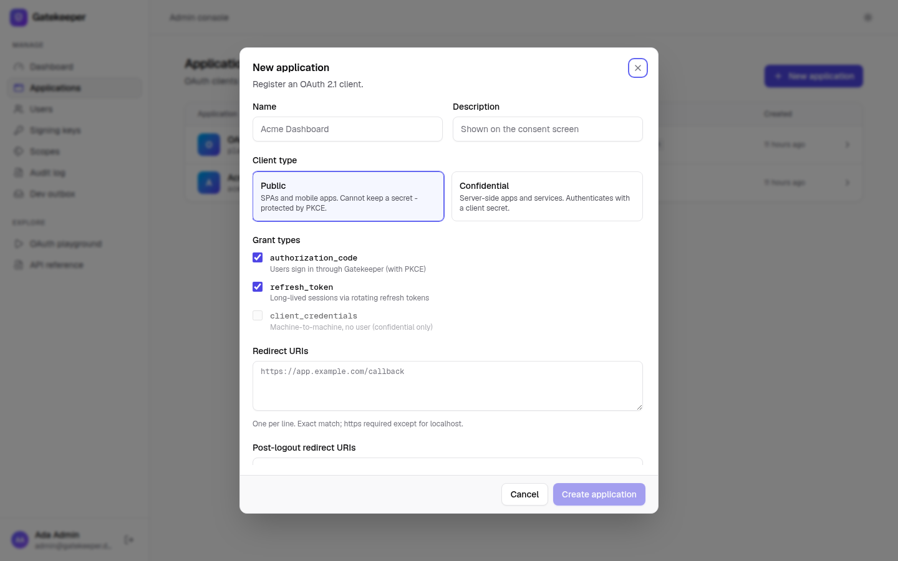 **Register a client** |
| 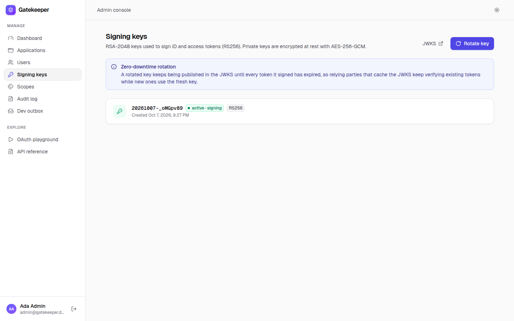 **Signing key rotation** | 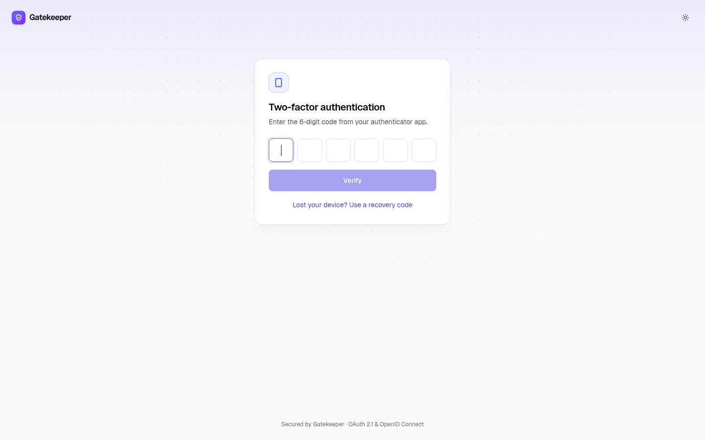 **TOTP second factor** |
| 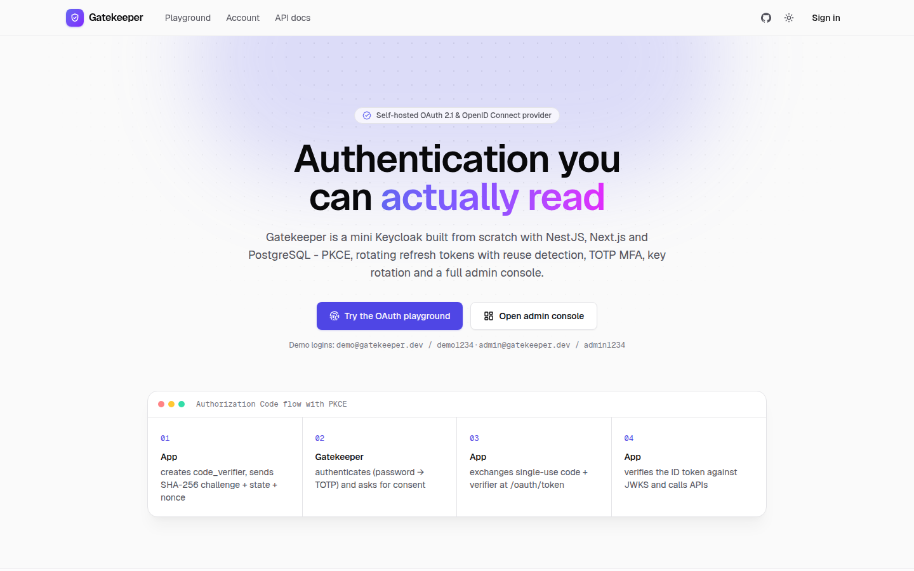 **Landing page** | 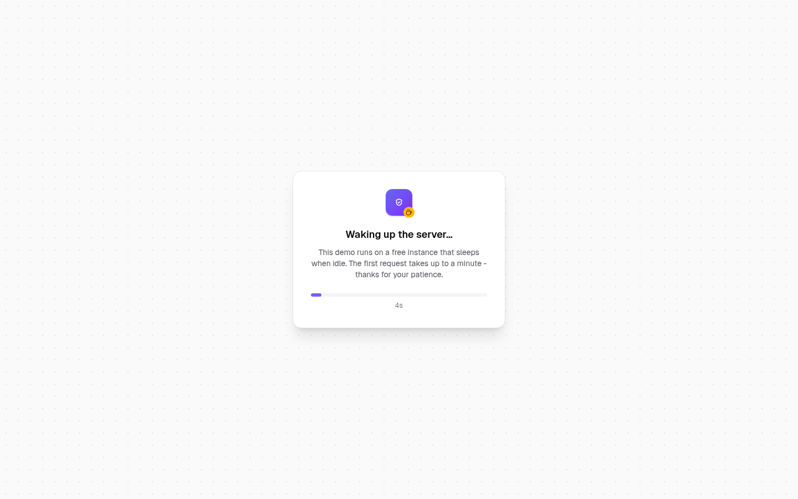 **Cold-start screen** while the free API instance boots |

## Architecture

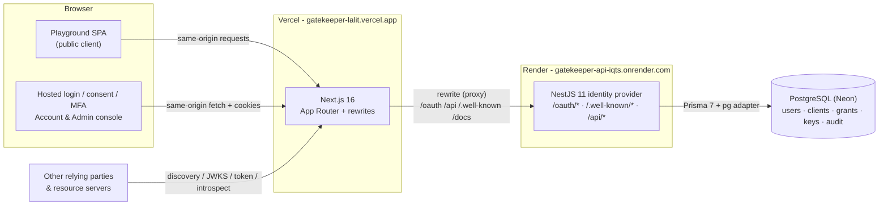

| Path                     | Owner         | Purpose                                                  |
| ------------------------ | ------------- | -------------------------------------------------------- |
| `apps/api`               | NestJS 11     | Issuer: protocol endpoints, sessions, MFA, admin REST API |
| `apps/web`               | Next.js 16    | Hosted login/consent/MFA, account, admin console, playground |
| `packages/shared`        | zod           | Request schemas and response types shared by both apps  |

### Authorization Code + PKCE sequence

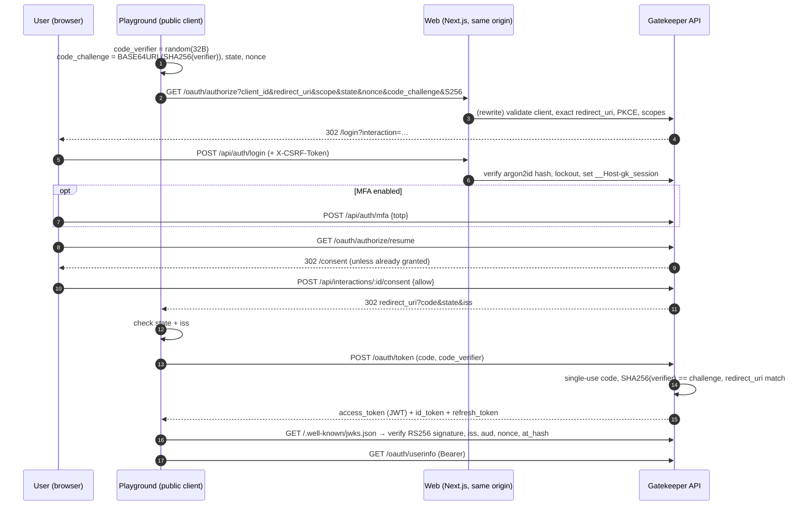

## Security design decisions

**First-party cookies across Vercel + Render.** `*.vercel.app` and `*.onrender.com` are both on the Public Suffix List, so a cookie set by the API's own domain would be a *third-party* cookie from the web app's point of view - blocked by Safari and Firefox today and by Chrome's tracking protections. Instead, Next.js **rewrites** `/oauth/*`, `/.well-known/*`, `/api/*`, `/health` and `/docs` to the API. The browser only ever talks to one origin, the session cookie is first-party, no CORS is needed for cookie-authenticated calls, and the **issuer URL is the web origin**. The API generates every URL from `ISSUER_URL`/`WEB_URL`, so it doesn't care which host it is reached through.

**Session cookie.** Random 256-bit token; only its SHA-256 is stored. `HttpOnly`, `Secure`, `__Host-` prefix in production (cannot be set by subdomains or shadowed), `SameSite=Lax` - `Lax` rather than `Strict` because the browser must send it on the top-level navigation from a relying party to `/oauth/authorize`, otherwise single sign-on could not work. The token is rotated when the MFA step completes and old sessions are revoked on login (no fixation).

**CSRF.** Cookie-authenticated JSON endpoints require a double-submit token (`__Host-gk_csrf` cookie echoed in `X-CSRF-Token`, compared in constant time) *and* reject foreign `Origin` headers. A custom header also forces a CORS preflight that `/api/*` never approves. RP-initiated logout without a valid `id_token_hint` asks the user to confirm (no drive-by logout).

**Authorization endpoint.** Unknown clients or unregistered redirect URIs are shown on Gatekeeper's own error page and **never redirected** (open-redirect protection). Redirect URIs must be absolute, fragment-free, wildcard-free, https (or loopback http / reverse-DNS native schemes) and are compared by exact string match. PKCE is mandatory for every client and only `S256` is accepted. The `iss` parameter is returned (RFC 9207) to defeat mix-up attacks.

**Codes and refresh tokens.** Authorization codes live 60 s, are stored hashed, and are **burned on the first redemption attempt** - even a failed one - so a stolen code can't be used to guess a verifier. Replaying a used code revokes every token minted from it (RFC 6749 §4.1.2). Refresh tokens are rotated on every use; each token is single-use (an atomic conditional update guards against races). Presenting a rotated-out token means it was copied, so the **entire grant ("token family") is revoked** and a `token.reuse_detected` audit event is written (OAuth 2.1 §4.3.1, Security BCP).

**JWTs and keys.** RS256 only (algorithm pinned on verification - no `alg: none`/HMAC confusion); the verifying key must be currently published. Access tokens are JWTs for resource servers, but their `jti` is also tracked so userinfo and introspection report revoked tokens as inactive immediately. Private keys are encrypted with AES-256-GCM using a key derived (HKDF) from `KEY_ENCRYPTION_SECRET`, with the `kid` bound as additional authenticated data; a wrong secret fails loudly at startup instead of silently minting new keys.

**Secrets at rest.** argon2id for passwords (19 MiB, t=2, p=1); SHA-256 for high-entropy random secrets (sessions, codes, refresh tokens, client secrets, recovery codes, email tokens) where slow hashing adds nothing; AES-256-GCM for TOTP secrets (they must be recoverable to verify codes).

**Brute force & enumeration.** Per-IP throttling on login/MFA/signup/reset; per-account lockout after 5 failures for 15 minutes (shared demo accounts exempt in demo mode so visitors can't lock each other out); unknown emails take the same time and return the same error as wrong passwords; password-reset requests always answer 200. Pending MFA sign-ins die after 5 wrong codes.

**Hygiene.** helmet (CSP, `frame-ancestors 'none'`, HSTS in production, `no-referrer`), strict CSP + `X-Frame-Options: DENY` on the web app (clickjacking protection for the login page), zod validation of every request body and of the environment at startup (fail fast, secrets never echoed), pino logs with `Authorization`, `Cookie`, `Set-Cookie` and sensitive query parameters (`code`, `id_token_hint`, …) redacted, email previews rendered in a fully sandboxed iframe.

## Tech stack

| Layer          | Choice                                                                                 |
| -------------- | -------------------------------------------------------------------------------------- |
| API            | NestJS 11, Express 5, Prisma 7 (`prisma-client` generator + `@prisma/adapter-pg`), PostgreSQL 17 |
| Crypto         | `jose` (JWS), Node `crypto` (RSA keygen, AES-256-GCM, HKDF, HMAC-based TOTP), `@node-rs/argon2` |
| Security       | helmet, `@nestjs/throttler`, custom CSRF middleware, zod                               |
| Web            | Next.js 16 (App Router, Turbopack), React 19, Tailwind CSS v4, SWR, next-themes, lucide |
| Observability  | nestjs-pino (structured JSON logs), `/health`, Swagger / OpenAPI                        |
| Testing        | Vitest 4 (+ SWC for Nest decorators), Supertest, real Postgres in Docker / GitHub Actions |
| Tooling        | npm workspaces, TypeScript 5.9 strict, ESLint 9 flat config (type-aware), Prettier      |
| Delivery       | Docker multi-stage images, docker-compose, GitHub Actions, Render (API), Vercel (web), Neon (DB) |

## Getting started

Requirements: Node 24 (`.nvmrc`), npm, Docker.

```bash
npm install
cp apps/api/.env.example apps/api/.env       # local defaults
cp apps/web/.env.example apps/web/.env.local
npm run db:up                                  # Postgres on localhost:5435
npm run generate                               # shared package + Prisma client + Next route types
npm run db:migrate                             # apply migrations
npm run db:seed                                # demo users, playground client, scopes
npm run dev:api                                # http://localhost:4500
npm run dev:web                                # http://localhost:3500  ← open this one
```

Or run everything in containers (web on **3500**, API on **4500**, Postgres on **5435**):

```bash
docker compose up --build
```

Useful URLs (all via the web origin): `/playground`, `/admin`, `/account`, `/docs` (Swagger), `/.well-known/openid-configuration`, `/health`.

### Try the API with curl

```bash
# machine-to-machine token
curl -s -u acme-reports:gks_demo_acme_reports_secret_change_me \
  -d grant_type=client_credentials http://localhost:3500/oauth/token

# introspect any token as the confidential client
curl -s -u acme-reports:gks_demo_acme_reports_secret_change_me \
  -d token=<access_token> http://localhost:3500/oauth/introspect
```

## Environment variables

**API (`apps/api`)** - validated with zod on startup.

| Variable                 | Required | Description |
| ------------------------ | -------- | ----------- |
| `DATABASE_URL`           | ✅ | Postgres connection used at runtime (Neon **pooled** URL in production). |
| `DIRECT_URL`             |    | Direct (non-pooled) URL for `prisma migrate deploy`; falls back to `DATABASE_URL`. |
| `ISSUER_URL`             | ✅ | Public issuer = origin the browser sees (the web app), e.g. `https://gatekeeper-lalit.vercel.app`. |
| `WEB_URL`                | ✅ | Origin of the hosted UI (same as `ISSUER_URL` with the proxy setup). |
| `KEY_ENCRYPTION_SECRET`  | ✅ | ≥ 32 chars; derives the AES-256-GCM key for signing keys and TOTP secrets. `openssl rand -base64 48`. Keep it stable. |
| `NODE_ENV`               |    | `production` enables secure defaults. |
| `PORT`                   |    | Default `4500`. |
| `COOKIE_SECURE`          |    | Secure + `__Host-` cookies. Defaults to `true` in production. |
| `TRUST_PROXY`            |    | Express `trust proxy` (hop count or subnets) for correct client IPs. `2` behind Vercel → Render. |
| `DEMO_MODE`              |    | Protect seeded accounts/clients, synthetic dashboard history, periodic reset. |
| `DEMO_RESET_CRON`        |    | Reset schedule in demo mode (default `0 */6 * * *`). |
| `SEED_ON_BOOT`           |    | Seed demo data on startup when the database is empty. |
| `MAIL_DRIVER`            |    | `outbox` (store emails in DB, view in admin) or `console`. |
| `LOG_LEVEL`              |    | pino level (default `info`). |
| `ACCESS_TOKEN_TTL`, `ID_TOKEN_TTL`, `SESSION_TTL`, `RETIRED_KEY_TTL`, `LOGIN_MAX_FAILURES`, `LOGIN_LOCKOUT_SECONDS` | | Optional tuning (seconds / counts). |

**Web (`apps/web`)**

| Variable                 | Required | Description |
| ------------------------ | -------- | ----------- |
| `API_INTERNAL_URL`       | ✅ | Where Next.js proxies protocol/API routes, e.g. `https://gatekeeper-api-iqts.onrender.com`. **Read at build time** (rewrites are compiled). |
| `NEXT_PUBLIC_GITHUB_URL` |    | Repository link in the header. |
| `NEXT_PUBLIC_HIDE_DEMO_CREDENTIALS` | | `true` hides the demo-account shortcuts on the login page. |

## Testing

```bash
npm run lint && npm run format:check && npm run typecheck
npm test            # unit tests (API + web)
npm run test:e2e    # e2e against Postgres (database gatekeeper_test on :5435, created by docker/postgres-init.sql)
```

| Suite | Tests | Highlights |
| ----- | ----- | ---------- |
| API unit (Vitest) | 84 | RFC 7636 PKCE vector, RFC 4226/6238 TOTP vectors + replay, scope & redirect-URI rules, token rotation & family revocation, code reuse, client authentication, key rotation + JWKS + tampered/`alg:none` tokens, AES-GCM, env validation, log redaction |
| Web unit (Vitest) | 8 | Browser PKCE/`at_hash`, JWT decoding, formatting |
| API e2e (Vitest + Supertest, real Postgres) | 74 | Full browser-side code flow with PKCE and JWKS verification; wrong/missing verifier, reused code (revokes tokens), mismatched `redirect_uri`, unregistered redirect never followed, `prompt=none/login`, consent denial and cross-session consent; refresh rotation and **reuse ⇒ family revoked**; revocation, introspection, `client_credentials`; RP-initiated logout; CSRF; lockout and rate limiting; MFA enrollment, replay and recovery codes; password reset; admin API and key rotation |

CI (`.github/workflows/ci.yml`) runs install → generate → lint → format check → typecheck → unit → e2e (Postgres service) → build on every push and PR.

## Deployment (Neon → Render → Vercel)

1. **Neon** - create a project/database. Copy the **pooled** connection string (host contains `-pooler`) and the **direct** one, both with `?sslmode=require`.
2. **Render (API)** - *New → Blueprint* from this repo; `render.yaml` defines a free `gatekeeper-api` web service in Oregon that builds from the monorepo root, runs `prisma migrate deploy` on start and health-checks `/health`. Set the `sync: false` secrets: `DATABASE_URL` (pooled), `DIRECT_URL` (direct) and `KEY_ENCRYPTION_SECRET` (`openssl rand -base64 48`). `ISSUER_URL`/`WEB_URL` default to `https://gatekeeper-lalit.vercel.app` - change them if your Vercel URL differs. First boot seeds the demo data.
3. **Vercel (web)** - import the repo, set **Root Directory = `apps/web`** (the `vercel.json` there installs and builds from the monorepo root) and add `API_INTERNAL_URL=https://gatekeeper-api-iqts.onrender.com`. Deploy.
4. Open `https://gatekeeper-lalit.vercel.app/.well-known/openid-configuration` - the issuer must equal the Vercel origin - then run the playground flow.

## Known limitations

- **Demo trade-offs.** The admin credentials are public, so anyone can view the dev outbox (which contains verification/reset links for visitor-created accounts) and edit non-protected data; data resets every 6 hours. Do not reuse real passwords on the demo.
- **No real email delivery.** The mailer is an interface with `outbox` and `console` transports; an SMTP/Resend/SES transport is a ~20-line addition but isn't included.
- **JWT access tokens are self-contained.** Resource servers that validate locally (via JWKS) only see revocation when tokens expire (default 15 min); introspection and userinfo reflect revocation immediately.
- **Not implemented:** dynamic client registration, PAR / JAR / request objects, `response_mode=form_post`, DPoP / mTLS sender-constrained tokens, WebAuthn/passkeys, social login, multi-tenancy/realms, per-client signing algorithms, an i18n'd UI.
- **Single-region in-memory caches** (active key cached for 60 s, scope list for 30 s) - fine for one instance; multiple instances converge within those windows.
- **Client IPs behind two proxies** depend on `TRUST_PROXY` matching the real hop count (Vercel → Render). Verify the IPs in the audit log after deploying; if the hop count is wrong, visitors may share a single rate-limit bucket (or IPs could be spoofed if set too high).
- The playground stores its demo tokens in `sessionStorage` so they survive the redirect round trip; production SPAs should keep tokens in memory or use a backend-for-frontend.

## License

[MIT](LICENSE) © Lalit Rajak
